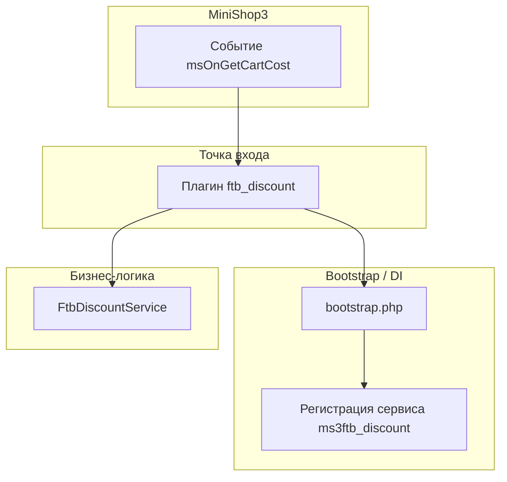
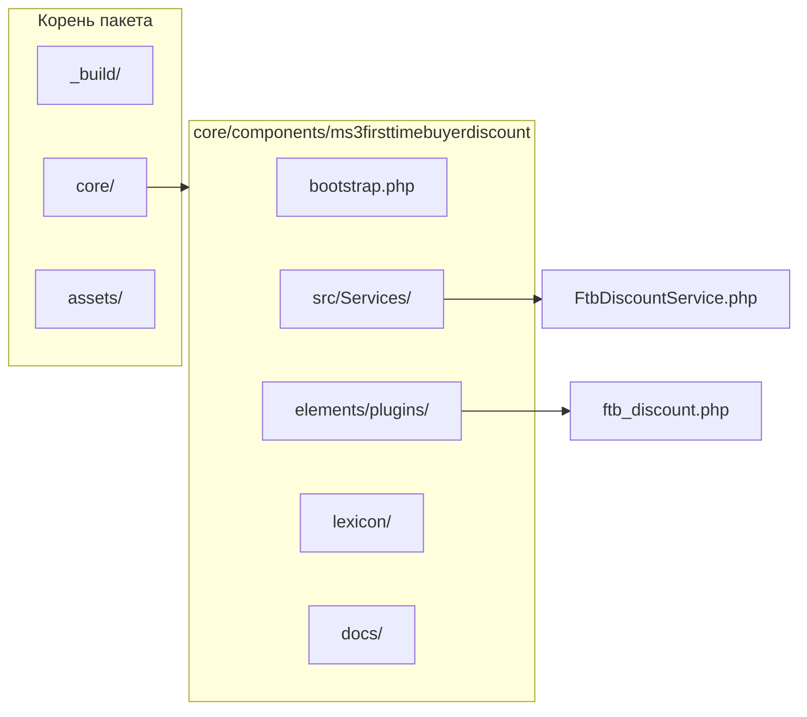
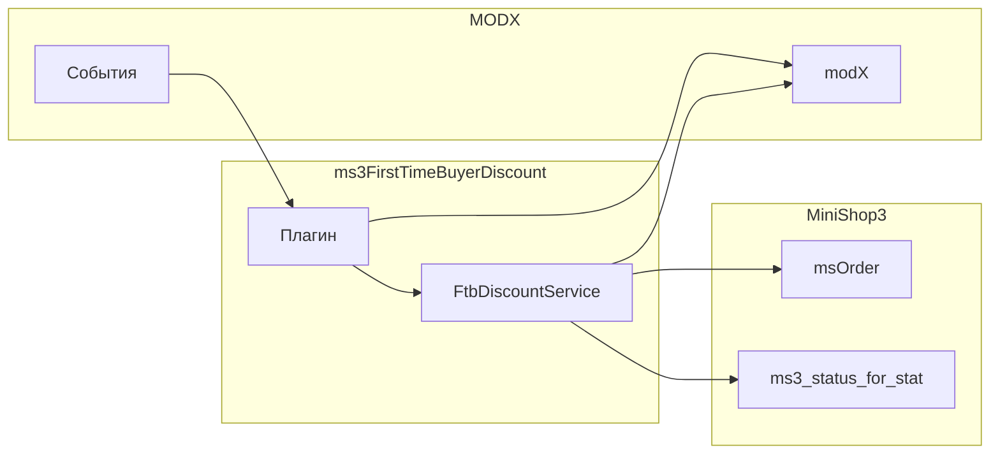
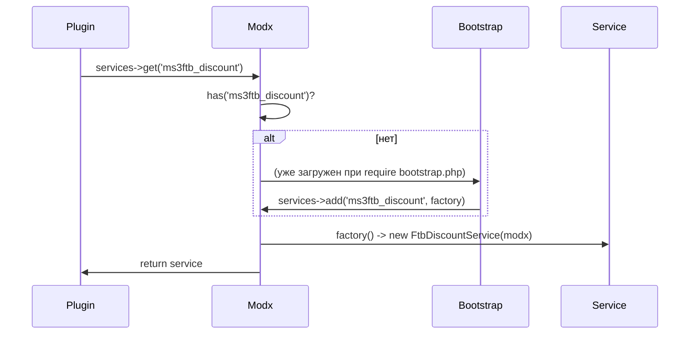

# Архитектура компонента ms3FirstTimeBuyerDiscount

## Обзор слоёв

Компонент состоит из трёх основных слоёв: точка входа (плагин), bootstrap/DI, бизнес-логика (сервис).

## Структура компонента

## Зависимости

- **MODX** (`modX`): конфиг, пользователь, события, лог, getOption, getCount.
- **MiniShop3**: модель `msOrder` (подсчёт заказов), настройка `ms3_status_for_stat`.
- **События MODX**: `msOnGetCartCost` (вход), `ftbOnBeforeApply`, `ftbOnApply` (внутренние).

## Регистрация сервиса

Сервис регистрируется в контейнере MODX под ключом `ms3ftb_discount` и создаётся лениво (при первом обращении).

## Расширяемость

- **Сервис**: можно подменить реализацию через свой пакет/резолвер и регистрировать другой класс под ключом `ms3ftb_discount`.
- **События**: плагины на `ftbOnBeforeApply` могут отменить применение (`returnedValues['apply'] = false`) или подменить базовую сумму (`returnedValues['cost']`); `ftbOnApply` — уведомление после успешного применения.

См. [API и события](api.md) и [Расширение](extension.md).
