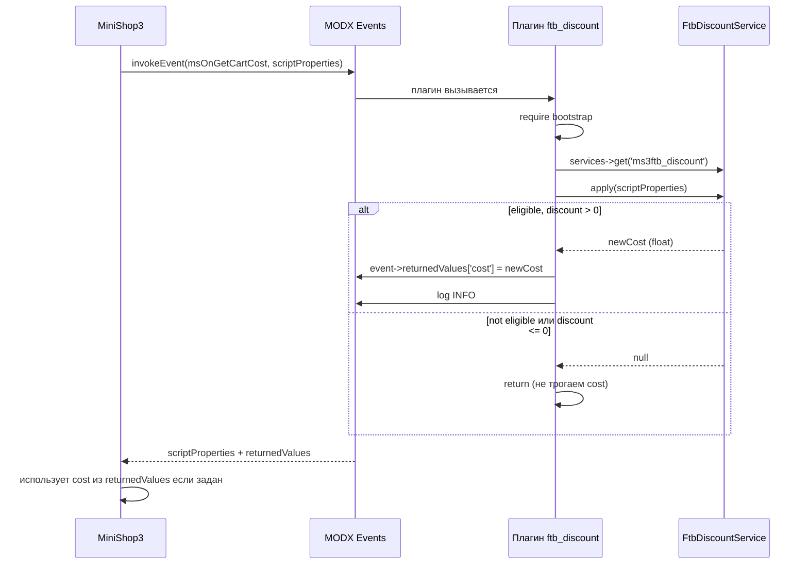
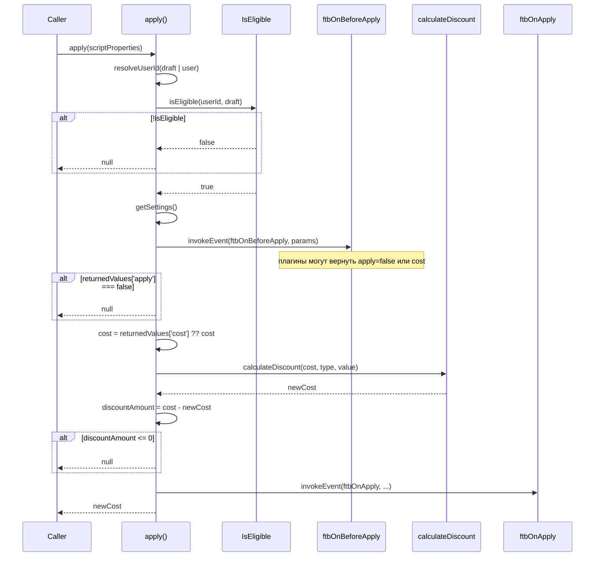
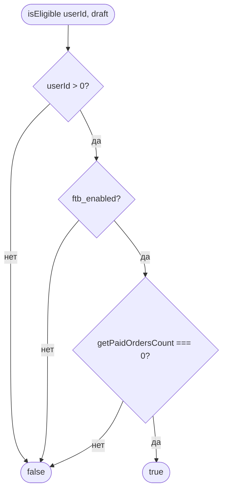
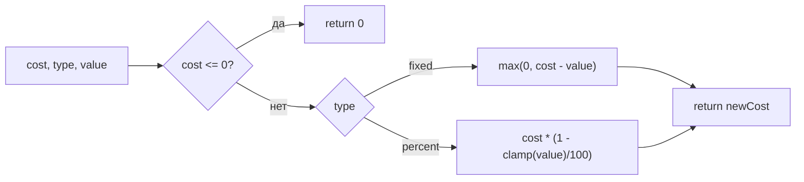

# Потоки (flows)

## Общий поток: расчёт стоимости корзины MiniShop3

MiniShop3 вызывает событие `msOnGetCartCost` с текущей стоимостью; плагины могут изменить её через `returnedValues['cost']`.

## Поток принятия решения о скидке (FtbDiscountService::apply)

Внутри `apply()` выполняются проверка прав, событие «до», расчёт и событие «после».

## Проверка права на скидку (isEligible)

Для авторизованных (`userId > 0`) считается число оплаченных заказов по `user_id`. Для гостей (`userId === 0`) — по email/телефону из `draft` (Address), если передан.

## Расчёт скидки (calculateDiscount)

- **percent**: `cost * (1 - value/100)`, value ограничен 0–100.
- **fixed**: `max(0, cost - value)`.

